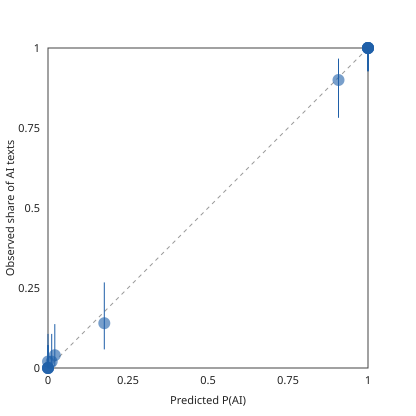

# Calibration pilot (calibration_pilot_v1)

Scorer: `gpttrace_v8s_1b_typography_off`. Input: `results/bias_v1/scores.jsonl` (SHA 256 `bc35e74d08e4ba868c54e97681697a88106d626c3f80c4eb01eec97637a7c16d`).
Fitted on 394 human and 352 AI texts, so P(AI) assumes that mix.
The interval is the 90% range. Seed `20261118`.

This is a pilot on 2023 data from one source. It checks that the calibration layer works. It is not evidence about release quality.

## Held out results (5 fold cross validation)

* ECE (15 equal mass bins): 0.0061
* Brier score: 0.0197
* Decision threshold tau per fold: 0.500, 0.500, 0.500, 0.500, 0.500
* Human texts of 150+ words labelled Likely AI: 2/239 (95% interval 0.1% to 3.0%)

| Bin | n | Mean predicted P(AI) | Observed share of AI | 95% interval |
|---|---|---|---|---|
| 1 | 50 | 0.000 | 0.000 | 0.000 to 0.071 |
| 2 | 50 | 0.000 | 0.000 | 0.000 to 0.071 |
| 3 | 50 | 0.000 | 0.000 | 0.000 to 0.071 |
| 4 | 50 | 0.000 | 0.000 | 0.000 to 0.071 |
| 5 | 50 | 0.000 | 0.020 | 0.001 to 0.106 |
| 6 | 50 | 0.012 | 0.020 | 0.001 to 0.106 |
| 7 | 50 | 0.021 | 0.040 | 0.005 to 0.137 |
| 8 | 50 | 0.176 | 0.140 | 0.058 to 0.267 |
| 9 | 50 | 0.908 | 0.900 | 0.782 to 0.967 |
| 10 | 50 | 1.000 | 1.000 | 0.929 to 1.000 |
| 11 | 50 | 1.000 | 1.000 | 0.929 to 1.000 |
| 12 | 49 | 1.000 | 1.000 | 0.927 to 1.000 |
| 13 | 49 | 1.000 | 1.000 | 0.927 to 1.000 |
| 14 | 49 | 1.000 | 1.000 | 0.927 to 1.000 |
| 15 | 49 | 1.000 | 1.000 | 0.927 to 1.000 |

Verdicts apply the length rule, so shorter texts receive no verdict. The last column counts texts whose lower bound reaches tau when length is ignored.

| Group | Role | n | Median P(AI) | Texts of 150+ words | Likely AI | Likely human | Can't tell | Lower bound at or above tau, any length |
|---|---|---|---|---|---|---|---|---|
| TOEFL_real_91 | human_nonnative | 91 | 0.000 | 0 | 0 | 0 | 0 | 0 |
| HewlettStudentEssay_real_88 | human_native | 88 | 0.000 | 87 | 0 | 87 | 0 | 0 |
| CollegeEssay_real_70 | human_native | 70 | 0.000 | 70 | 1 | 69 | 0 | 1 |
| CS224N_real_145 | human_unknown | 145 | 0.013 | 82 | 1 | 75 | 6 | 2 |
| CollegeEssay_gpt3_31 | ai | 31 | 1.000 | 30 | 30 | 0 | 0 | 31 |
| CollegeEssay_gpt3PromptEng_31 | ai | 31 | 1.000 | 26 | 26 | 0 | 0 | 31 |
| CS224N_gpt3_145 | ai | 145 | 1.000 | 0 | 0 | 0 | 0 | 141 |
| CS224N_gpt3PromptEng_145 | ai | 145 | 1.000 | 1 | 1 | 0 | 0 | 133 |

## AI edited human text, scored with the final calibrator

The final calibrator is fitted on all labelled texts. Its tau is 0.500.

| Group | Role | n | Median P(AI) | Texts of 150+ words | Likely AI | Likely human | Can't tell | Lower bound at or above tau, any length |
|---|---|---|---|---|---|---|---|---|
| TOEFL_gpt4polished_91 | ai_edited | 91 | 1.000 | 0 | 0 | 0 | 0 | 77 |
| HewlettStudentEssay_GPTsimplify_88 | ai_edited | 88 | 0.600 | 14 | 8 | 5 | 1 | 41 |
