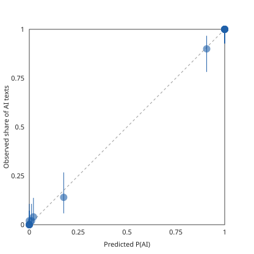

# Calibration pilot (calibration_pilot_v2)

Scorer: `gpttrace_v8s_1b_typography_off`. Input: `results/bias_v1/scores.jsonl` (SHA 256 `bc35e74d08e4ba868c54e97681697a88106d626c3f80c4eb01eec97637a7c16d`).
Fitted on 394 human and 352 AI texts, so P(AI) assumes that mix.
The interval is the 90% range. Seed `20261118`.

This is a pilot on 2023 data from one source. It checks that the calibration and abstention layers work. It is not evidence about release quality.

## Calibration map, held out (5 fold cross validation)

* ECE (15 equal mass bins): 0.0061
* Brier score: 0.0197
* Decision threshold tau per fold: 0.500, 0.500, 0.500, 0.500, 0.500

| Bin | n | Mean predicted P(AI) | Observed share of AI | 95% interval |
|---|---|---|---|---|
| 1 | 50 | 0.000 | 0.000 | 0.000 to 0.071 |
| 2 | 50 | 0.000 | 0.000 | 0.000 to 0.071 |
| 3 | 50 | 0.000 | 0.000 | 0.000 to 0.071 |
| 4 | 50 | 0.000 | 0.000 | 0.000 to 0.071 |
| 5 | 50 | 0.000 | 0.020 | 0.001 to 0.106 |
| 6 | 50 | 0.012 | 0.020 | 0.001 to 0.106 |
| 7 | 50 | 0.021 | 0.040 | 0.005 to 0.137 |
| 8 | 50 | 0.176 | 0.140 | 0.058 to 0.267 |
| 9 | 50 | 0.908 | 0.900 | 0.782 to 0.967 |
| 10 | 50 | 1.000 | 1.000 | 0.929 to 1.000 |
| 11 | 50 | 1.000 | 1.000 | 0.929 to 1.000 |
| 12 | 49 | 1.000 | 1.000 | 0.927 to 1.000 |
| 13 | 49 | 1.000 | 1.000 | 0.927 to 1.000 |
| 14 | 49 | 1.000 | 1.000 | 0.927 to 1.000 |
| 15 | 49 | 1.000 | 1.000 | 0.927 to 1.000 |

## Conformal abstention layer, held out

"Human" may be ruled out for at most 1% of human texts and "AI" for at most 5% of AI texts. A class can be ruled out only in a band with at least 99 human or 19 AI calibration texts. All counts are for held out texts of 150 words or more, with 95% Clopper Pearson intervals.

**Result under the reading fixed before the run: the banded layer does not fail and the single band layer does not fail.**

| Rule | Human texts labelled Likely AI | Human texts with "human" ruled out | AI texts labelled Likely human | AI texts with "AI" ruled out |
|---|---|---|---|---|
| Interval rule alone | 2/239 (0.1% to 3.0%) | | 0/57 (0.0% to 6.3%) | |
| With the banded layer | 0/239 (0.0% to 1.5%) | 0/239 (0.0% to 1.5%) | 0/57 (0.0% to 6.3%) | 1/57 (0.0% to 9.4%) |
| With the single band layer | 0/239 (0.0% to 1.5%) | 1/239 (0.0% to 2.3%) | 0/57 (0.0% to 6.3%) | 3/57 (1.1% to 14.6%) |

| Rule | Class | Likely AI | Likely human | Can't tell | No verdict |
|---|---|---|---|---|---|
| Interval rule alone | human | 2 | 231 | 6 | 0 |
| Interval rule alone | ai | 57 | 0 | 0 | 0 |
| With the banded layer | human | 0 | 131 | 7 | 101 |
| With the banded layer | ai | 0 | 0 | 39 | 18 |
| With the single band layer | human | 0 | 231 | 8 | 0 |
| With the single band layer | ai | 54 | 0 | 3 | 0 |

## Bands of the final banded layer

The final layer is fitted on all labelled texts and written to `calibration.json`. The single band layer is written to `calibration_single_band.json`.

| Words | Human texts | AI texts | Can label as AI | Can label as human |
|---|---|---|---|---|
| 150 to 249 | 68 | 23 | no | yes |
| 250 to 499 | 98 | 34 | no | yes |
| 500 or more | 73 | 0 | no | no |

## Verdicts per group, held out, with the banded layer

Shorter texts receive no verdict and are not counted in the verdict columns. The last column counts texts whose lower bound reaches tau when length is ignored.

| Group | Role | n | Median P(AI) | Texts of 150+ words | Likely AI | Likely human | Can't tell | No verdict | Lower bound at or above tau, any length |
|---|---|---|---|---|---|---|---|---|---|
| TOEFL_real_91 | human_nonnative | 91 | 0.000 | 0 | 0 | 0 | 0 | 0 | 0 |
| HewlettStudentEssay_real_88 | human_native | 88 | 0.000 | 87 | 0 | 66 | 0 | 21 | 0 |
| CollegeEssay_real_70 | human_native | 70 | 0.000 | 70 | 0 | 11 | 0 | 59 | 1 |
| CS224N_real_145 | human_unknown | 145 | 0.013 | 82 | 0 | 54 | 7 | 21 | 2 |
| CollegeEssay_gpt3_31 | ai | 31 | 1.000 | 30 | 0 | 0 | 22 | 8 | 31 |
| CollegeEssay_gpt3PromptEng_31 | ai | 31 | 1.000 | 26 | 0 | 0 | 17 | 9 | 31 |
| CS224N_gpt3_145 | ai | 145 | 1.000 | 0 | 0 | 0 | 0 | 0 | 141 |
| CS224N_gpt3PromptEng_145 | ai | 145 | 1.000 | 1 | 0 | 0 | 0 | 1 | 133 |

## AI edited human text, scored with the final calibrator and the final banded layer

The final calibrator is fitted on all labelled texts. Its tau is 0.500.

| Group | Role | n | Median P(AI) | Texts of 150+ words | Likely AI | Likely human | Can't tell | No verdict | Lower bound at or above tau, any length |
|---|---|---|---|---|---|---|---|---|---|
| TOEFL_gpt4polished_91 | ai_edited | 91 | 1.000 | 0 | 0 | 0 | 0 | 0 | 77 |
| HewlettStudentEssay_GPTsimplify_88 | ai_edited | 88 | 0.600 | 14 | 0 | 5 | 9 | 0 | 41 |
