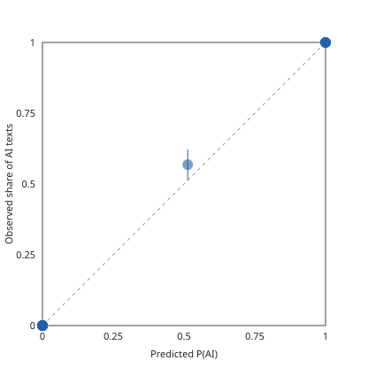

# Evaluation run on the test split

Plan: `eval_plan_v1`. Scorer: `gpttrace_v8s_1b_typography_off` (nakas/gpttrace-v8s-1b at revision `ac748e32ca8c`). Seed `20261119`. Intervals are 95% Clopper Pearson.

## What this run covers

| Part of the plan | Status |
|---|---|
| M1, true positive rate at 1% false positive rate | computed |
| M2, calibration of the document probability | computed |
| M2, calibration of a sentence probability | not computed: the command gives no sentence probability |
| M3, nonnative release gate | not evaluable |
| M4, paraphrase and humanizer attacks | not run: the corpora hold no attacked text |
| Verdict rules and rates | computed |
| Revision mode metrics (§3) | not run: revision mode does not exist |
| RAID submission (§5) | not run |

## Data

Fitted on 3941 human and 1886 AI texts, so P(AI) assumes that mix. Measured on 3578 human and 1567 AI texts.

| Source and class | Fitting | Measuring |
|---|---|---|
| ellipse/human | 3237 | 3245 |
| liang/ai | 348 | 0 |
| liang/human | 393 | 0 |
| meld/ai | 1508 | 1541 |
| textsight/ai | 30 | 26 |
| textsight/human | 311 | 333 |

What these corpora can and cannot show:

* **The human and the AI texts are of different kinds.** Most human texts are school essays by English learners (ELLIPSE). Most AI texts are answers of 2026 chat models in eight other domains (MELD-eval). The false positive rate on essays and the true positive rate on chat model text are each valid for their kind of text. Any number that mixes the classes (AUROC, ECE, P(AI)) also reflects the difference in kind, which makes the classes easier to separate than authorship alone would.
* **There is no native human text on test.** The only native essays are those of the pilots, which may be used for fitting only. The ratio of M3 cannot be computed.
* **Nonnative means two things here:** school essays by English learners in the United States, and passages of research papers whose authors work in countries where English is not the main language. The second is the label of the TextSight benchmark and is an inference from the affiliation.
* **No AI text is a student essay** except the 2023 GPT 3 essays of the pilots, which are in fitting only.
* **The scorer's author reports results on MELD-eval and on the TextSight benchmark.** Neither is listed as training data, but both may have guided the choice of the released model.
* **Human texts taken from RAID are left out of every rate above the last section.** The scorer was trained on RAID, so its scores on them say nothing about unseen human text.

## M1: true positive rate at a 1% false positive rate

The threshold `7.568` on the raw score flags 1.0% of the human texts used for fitting. It is applied unchanged below.

* **True positive rate:** 1557/1567 = 99.4% (98.8% to 99.7%)
* **Realized false positive rate (nominal 1.0%):** 1/3578 = 0.0% (0.0% to 0.2%)

Human texts by writer group. A stratum supports a claim of 1% or lower only with at least 300 texts.

| Writer group | Flagged | Enough texts for the claim |
|---|---|---|
| nonnative | 1/3342 = 0.0% (0.0% to 0.2%) | yes |
| unknown | 0/236 = 0.0% (0.0% to 1.6%) | no |

Human texts by length in words. A stratum supports a claim of 1% or lower only with at least 300 texts.

| Length in words | Flagged | Enough texts for the claim |
|---|---|---|
| under 100 | 0/26 = 0.0% (0.0% to 13.2%) | no |
| 100 to 149 | 1/111 = 0.9% (0.0% to 4.9%) | no |
| 150 to 249 | 0/679 = 0.0% (0.0% to 0.5%) | yes |
| 250 to 499 | 0/1886 = 0.0% (0.0% to 0.2%) | yes |
| 500 or more | 0/876 = 0.0% (0.0% to 0.4%) | yes |

Human texts by domain. A stratum supports a claim of 1% or lower only with at least 300 texts.

| Domain | Flagged | Enough texts for the claim |
|---|---|---|
| academic | 1/97 = 1.0% (0.0% to 5.6%) | no |
| encyclopedic | 0/63 = 0.0% (0.0% to 5.7%) | no |
| literature | 0/173 = 0.0% (0.0% to 2.1%) | no |
| student_essay | 0/3245 = 0.0% (0.0% to 0.1%) | yes |

Human texts by source. A stratum supports a claim of 1% or lower only with at least 300 texts.

| Source | Flagged | Enough texts for the claim |
|---|---|---|
| ellipse | 0/3245 = 0.0% (0.0% to 0.1%) | yes |
| textsight | 1/333 = 0.3% (0.0% to 1.7%) | yes |

AI texts by generator.

| Generator | Flagged |
|---|---|
| claude-haiku | 383/383 = 100.0% (99.0% to 100.0%) |
| claude-haiku-4-5 | 4/4 = 100.0% (39.8% to 100.0%) |
| claude-opus-5 | 5/7 = 71.4% (29.0% to 96.3%) |
| gemini-3-flash | 404/405 = 99.8% (98.6% to 100.0%) |
| gpt-4.1 | 6/6 = 100.0% (54.1% to 100.0%) |
| gpt-5.4-mini | 372/378 = 98.4% (96.6% to 99.4%) |
| gpt-oss-120b | 6/6 = 100.0% (54.1% to 100.0%) |
| qwen-3.6-plus | 374/375 = 99.7% (98.5% to 100.0%) |
| qwen-3.8-27b | 3/3 = 100.0% (29.2% to 100.0%) |

AI texts by length in words.

| Length in words | Flagged |
|---|---|
| 100 to 149 | 3/3 = 100.0% (29.2% to 100.0%) |
| 150 to 249 | 225/228 = 98.7% (96.2% to 99.7%) |
| 250 to 499 | 899/903 = 99.6% (98.9% to 99.9%) |
| 500 or more | 430/433 = 99.3% (98.0% to 99.9%) |

AI texts by domain.

| Domain | Flagged |
|---|---|
| abstracts | 236/239 = 98.7% (96.4% to 99.7%) |
| academic | 13/13 = 100.0% (75.3% to 100.0%) |
| books | 182/184 = 98.9% (96.1% to 99.9%) |
| encyclopedic | 11/13 = 84.6% (54.6% to 98.1%) |
| news | 190/190 = 100.0% (98.1% to 100.0%) |
| poetry | 185/186 = 99.5% (97.0% to 100.0%) |
| recipes | 185/185 = 100.0% (98.0% to 100.0%) |
| reddit | 196/197 = 99.5% (97.2% to 100.0%) |
| reviews | 186/186 = 100.0% (98.0% to 100.0%) |
| wiki | 173/174 = 99.4% (96.8% to 100.0%) |

## Secondary metrics

* AUROC: 1.0000
* At a nominal false positive rate of 0.1% (threshold `9.075`): true positive rate 1532/1567 = 97.8% (96.9% to 98.4%), realized false positive rate 0/3578 = 0.0% (0.0% to 0.1%)
* At a nominal false positive rate of 5.0% (threshold `3.273`): true positive rate 1566/1567 = 99.9% (99.6% to 100.0%), realized false positive rate 35/3578 = 1.0% (0.7% to 1.4%)
* Latency: not measured.

## M2: calibration of P(AI)

* **ECE (15 equal mass bins):** 0.0037. Target: at most 0.03. Met: yes.
* **Brier score:** 0.0028

| Bin | n | Mean predicted P(AI) | Observed share of AI | 95% interval |
|---|---|---|---|---|
| 1 | 343 | 0.000 | 0.000 | 0.000 to 0.011 |
| 2 | 343 | 0.000 | 0.000 | 0.000 to 0.011 |
| 3 | 343 | 0.000 | 0.000 | 0.000 to 0.011 |
| 4 | 343 | 0.000 | 0.000 | 0.000 to 0.011 |
| 5 | 343 | 0.000 | 0.000 | 0.000 to 0.011 |
| 6 | 343 | 0.000 | 0.000 | 0.000 to 0.011 |
| 7 | 343 | 0.000 | 0.000 | 0.000 to 0.011 |
| 8 | 343 | 0.000 | 0.000 | 0.000 to 0.011 |
| 9 | 343 | 0.000 | 0.000 | 0.000 to 0.011 |
| 10 | 343 | 0.000 | 0.000 | 0.000 to 0.011 |
| 11 | 343 | 0.513 | 0.569 | 0.514 to 0.622 |
| 12 | 343 | 1.000 | 1.000 | 0.989 to 1.000 |
| 13 | 343 | 1.000 | 1.000 | 0.989 to 1.000 |
| 14 | 343 | 1.000 | 1.000 | 0.989 to 1.000 |
| 15 | 343 | 1.000 | 1.000 | 0.989 to 1.000 |

Per stratum. The target of 0.05 applies to strata with at least 300 texts. A stratum with one class only measures how close P(AI) is to 0 or 1 for that class.

| Dimension | Stratum | n | AI texts | ECE | Brier | Meets target |
|---|---|---|---|---|---|---|
| length | under 100 | 26 | 0 | 0.0225 | 0.0038 | n/a |
| length | 100 to 149 | 114 | 3 | 0.0083 | 0.0036 | n/a |
| length | 150 to 249 | 907 | 228 | 0.0051 | 0.0038 | yes |
| length | 250 to 499 | 2789 | 903 | 0.0025 | 0.0017 | yes |
| length | 500 or more | 1309 | 433 | 0.0071 | 0.0043 | yes |
| domain | abstracts | 239 | 239 | 0.0115 | 0.0082 | n/a |
| domain | academic | 110 | 13 | 0.0069 | 0.0040 | n/a |
| domain | books | 184 | 184 | 0.0377 | 0.0212 | n/a |
| domain | encyclopedic | 76 | 13 | 0.0321 | 0.0255 | n/a |
| domain | literature | 173 | 0 | 0.0063 | 0.0007 | n/a |
| domain | news | 190 | 190 | 0.0031 | 0.0014 | n/a |
| domain | poetry | 186 | 186 | 0.0142 | 0.0102 | n/a |
| domain | recipes | 185 | 185 | 0.0069 | 0.0021 | n/a |
| domain | reddit | 197 | 197 | 0.0106 | 0.0073 | n/a |
| domain | reviews | 186 | 186 | 0.0000 | 0.0000 | n/a |
| domain | student_essay | 3245 | 0 | 0.0002 | 0.0000 | yes |
| domain | wiki | 174 | 174 | 0.0153 | 0.0115 | n/a |
| source | ellipse | 3245 | 0 | 0.0002 | 0.0000 | yes |
| source | meld | 1541 | 1541 | 0.0123 | 0.0077 | yes |
| source | textsight | 359 | 26 | 0.0036 | 0.0070 | yes |
| writer_group | nonnative | 3342 | 0 | 0.0004 | 0.0001 | yes |
| writer_group | unknown | 236 | 0 | 0.0046 | 0.0005 | n/a |
| generator | claude-haiku | 383 | 383 | 0.0020 | 0.0013 | yes |
| generator | claude-haiku-4-5 | 4 | 4 | 0.0000 | 0.0000 | n/a |
| generator | claude-opus-5 | 7 | 7 | 0.3110 | 0.2617 | n/a |
| generator | gemini-3-flash | 405 | 405 | 0.0114 | 0.0063 | yes |
| generator | gpt-4.1 | 6 | 6 | 0.0000 | 0.0000 | n/a |
| generator | gpt-5.4-mini | 378 | 378 | 0.0331 | 0.0218 | yes |
| generator | gpt-oss-120b | 6 | 6 | 0.0000 | 0.0000 | n/a |
| generator | qwen-3.6-plus | 375 | 375 | 0.0029 | 0.0015 | yes |
| generator | qwen-3.8-27b | 3 | 3 | 0.1544 | 0.0495 | n/a |

## M3: nonnative release gate

* Nonnative human texts flagged at the M1 threshold: 1/3342 = 0.0% (0.0% to 0.2%)
* Native human texts flagged at the M1 threshold: no texts
* Upper bound of the nonnative rate at most 2.0%: yes
* Ratio of the nonnative to the native rate, at most 1.5: n/a
* **Gate: not evaluable.**

## Verdict rules and rates

A label needs 150 words, the whole 90.0% interval on one side of tau (`0.500`), and a conformal prediction set that holds that class alone.

| Length band of the conformal layer | Human texts in fitting | AI texts in fitting | Can label as AI | Can label as human |
|---|---|---|---|---|
| 150 to 249 | 654 | 233 | yes | yes |
| 250 to 499 | 1904 | 946 | yes | yes |
| 500 or more | 1080 | 415 | yes | yes |

| Texts | Class | n | Likely AI | Likely human | Can't tell | No verdict | Wrong label | Own class ruled out |
|---|---|---|---|---|---|---|---|---|
| all lengths | human | 3578 | 0 | 3439 | 2 | 137 | 0/3578 = 0.0% (0.0% to 0.1%) | 2/3441 = 0.1% (0.0% to 0.2%) |
| all lengths | ai | 1567 | 1493 | 5 | 66 | 3 | 5/1567 = 0.3% (0.1% to 0.7%) | 71/1564 = 4.5% (3.6% to 5.7%) |
| 150 words or more | human | 3441 | 0 | 3439 | 2 | 0 | 0/3441 = 0.0% (0.0% to 0.1%) | 2/3441 = 0.1% (0.0% to 0.2%) |
| 150 words or more | ai | 1564 | 1493 | 5 | 66 | 0 | 5/1564 = 0.3% (0.1% to 0.7%) | 71/1564 = 4.5% (3.6% to 5.7%) |
| 150 to 249 | human | 679 | 0 | 679 | 0 | 0 | 0/679 = 0.0% (0.0% to 0.5%) | 0/679 = 0.0% (0.0% to 0.5%) |
| 150 to 249 | ai | 228 | 217 | 3 | 8 | 0 | 3/228 = 1.3% (0.3% to 3.8%) | 11/228 = 4.8% (2.4% to 8.5%) |
| 250 to 499 | human | 1886 | 0 | 1884 | 2 | 0 | 0/1886 = 0.0% (0.0% to 0.2%) | 2/1886 = 0.1% (0.0% to 0.4%) |
| 250 to 499 | ai | 903 | 854 | 1 | 48 | 0 | 1/903 = 0.1% (0.0% to 0.6%) | 49/903 = 5.4% (4.0% to 7.1%) |
| 500 or more | human | 876 | 0 | 876 | 0 | 0 | 0/876 = 0.0% (0.0% to 0.4%) | 0/876 = 0.0% (0.0% to 0.4%) |
| 500 or more | ai | 433 | 422 | 1 | 10 | 0 | 1/433 = 0.2% (0.0% to 1.3%) | 11/433 = 2.5% (1.3% to 4.5%) |

The wrong label for a human text is "Likely AI written or AI edited", the false accusation. For an AI text it is "Likely human written". The targets for ruling out the own class are 1.0% for human and 5.0% for AI texts.

## Reported on their own

* **Human texts taken from RAID, on which the scorer was trained:** flagged at the M1 threshold 1/567 = 0.2% (0.0% to 1.0%). Of the 530 with enough words: 0 Likely AI, 529 Likely human, 1 Can't tell, 0 no verdict.
* **Human texts that an AI edited:** none in this split.

## Inputs

* calib_manifest: SHA 256 `45a59e2b45633c23a589cdcbb1a8a5ff41314712931b8dc801abe65732ce59d7`
* test_manifest: SHA 256 `bd3820e2738af1e18fc544f7f3ea96450fd416594f3376821fbbe3b3fcdee98f`
* scores: SHA 256 `36ddef54326a1c2b294f713f2bbdeed01b8dd41e1334b5976deb017a756b7bc9`
