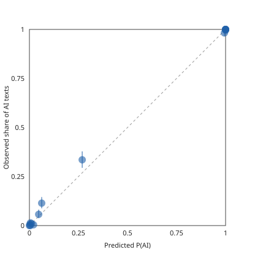
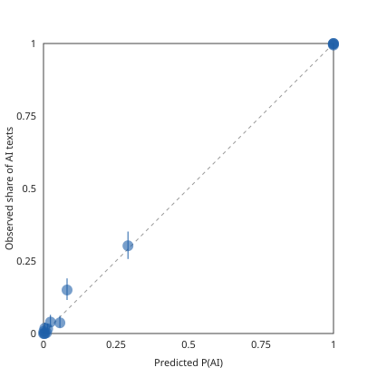

# Evaluation run of eval_plan_v2 on the test split

Plan: `eval_plan_v2`. Scorer: `gpttrace_v8s_1b_typography_off` (nakas/gpttrace-v8s-1b at revision `ac748e32ca8c`). Seed `20261119`. Intervals are 95% Clopper Pearson.

What these corpora can and cannot show:

* **The texts of eval_v1 have been seen.** Their results were published, so the claims of this run rest on the texts added for eval_plan_v2.
* **The 300 Claude essays are in fitting only.** They were scored before the plan was frozen.
* **Attacked texts are DIPPER paraphrases and AI rewrites of AI essays, from GEDE.** Commercial humanizers and light human edits are not covered.
* **Native human essays come from BAWE (GEDE):** students at UK universities whose first language is English. Nonnative essays are mostly those of ELLIPSE, written in US schools. The two groups also differ in age and level, so a gap between them is not due to the first language alone.
* **The writers of the Ghostbuster human essays are unknown.** They come from IvyPanda and are counted in neither writer group.
* **Generators fine tuned on student essays are few:** one model of DACTYL. The rate on them rests on few texts.

## All texts

Fitted on 4653 human and 4011 AI texts, so P(AI) assumes that mix. Measured on 4300 human and 3302 AI texts. Threshold of M1 `7.864`, tau `0.500`.

| Source and class | Fitting | Measuring |
|---|---|---|
| claude_essays/ai | 300 | 0 |
| dactyl/ai | 742 | 698 |
| ellipse/human | 3237 | 3245 |
| gede/ai | 381 | 339 |
| gede/human | 197 | 242 |
| ghostbuster/ai | 283 | 317 |
| ghostbuster/human | 515 | 480 |
| liang/ai | 348 | 0 |
| liang/human | 393 | 0 |
| meld/ai | 1508 | 1541 |
| qwen_essays/ai | 419 | 381 |
| textsight/ai | 30 | 26 |
| textsight/human | 311 | 333 |

### M1: true positive rate at a 1% false positive rate

* **True positive rate:** 3116/3302 = 94.4% (93.5% to 95.1%)
* **Realized false positive rate (nominal 1.0%):** 22/4300 = 0.5% (0.3% to 0.8%)

Human texts by source. A claim of 1% or lower needs 300 texts.

| Source | Flagged | Enough texts for the claim |
|---|---|---|
| ellipse | 0/3245 = 0.0% (0.0% to 0.1%) | yes |
| gede | 0/242 = 0.0% (0.0% to 1.5%) | no |
| ghostbuster | 21/480 = 4.4% (2.7% to 6.6%) | yes |
| textsight | 1/333 = 0.3% (0.0% to 1.7%) | yes |

Human texts by writer group. A claim of 1% or lower needs 300 texts.

| Writer group | Flagged | Enough texts for the claim |
|---|---|---|
| native | 0/181 = 0.0% (0.0% to 2.0%) | no |
| nonnative | 1/3403 = 0.0% (0.0% to 0.2%) | yes |
| unknown | 21/716 = 2.9% (1.8% to 4.4%) | yes |

Human texts by length in words. A claim of 1% or lower needs 300 texts.

| Length in words | Flagged | Enough texts for the claim |
|---|---|---|
| under 100 | 0/35 = 0.0% (0.0% to 10.0%) | no |
| 100 to 149 | 1/114 = 0.9% (0.0% to 4.8%) | no |
| 150 to 249 | 2/701 = 0.3% (0.0% to 1.0%) | yes |
| 250 to 499 | 15/2341 = 0.6% (0.4% to 1.1%) | yes |
| 500 or more | 4/1109 = 0.4% (0.1% to 0.9%) | yes |

AI texts by source.

| Source | Flagged |
|---|---|
| dactyl | 528/698 = 75.6% (72.3% to 78.8%) |
| gede | 339/339 = 100.0% (98.9% to 100.0%) |
| ghostbuster | 314/317 = 99.1% (97.3% to 99.8%) |
| meld | 1531/1541 = 99.4% (98.8% to 99.7%) |
| qwen_essays | 380/381 = 99.7% (98.5% to 100.0%) |
| textsight | 24/26 = 92.3% (74.9% to 99.1%) |

AI texts by generator.

| Generator | Flagged |
|---|---|
| DeepSeek-V3 | 55/55 = 100.0% (93.5% to 100.0%) |
| ShantanuT01/fine-tuned-Llama-3.2-1B-Instruct-apollo-mini-student_essays-testing | 1/31 = 3.2% (0.1% to 16.7%) |
| claude (2023) | 38/41 = 92.7% (80.1% to 98.5%) |
| claude-3-5-haiku-20241022 | 46/57 = 80.7% (68.1% to 90.0%) |
| claude-3-5-sonnet-20241022 | 33/52 = 63.5% (49.0% to 76.4%) |
| claude-haiku | 382/383 = 99.7% (98.6% to 100.0%) |
| claude-haiku-4-5 | 4/4 = 100.0% (39.8% to 100.0%) |
| claude-opus-5 | 5/7 = 71.4% (29.0% to 96.3%) |
| gemini-1.5-flash | 53/56 = 94.6% (85.1% to 98.9%) |
| gemini-1.5-pro | 50/61 = 82.0% (70.0% to 90.6%) |
| gemini-3-flash | 404/405 = 99.8% (98.6% to 100.0%) |
| gpt-3.5-turbo (2023) | 276/276 = 100.0% (98.7% to 100.0%) |
| gpt-4.1 | 6/6 = 100.0% (54.1% to 100.0%) |
| gpt-4o-2024-11-20 | 55/58 = 94.8% (85.6% to 98.9%) |
| gpt-4o-mini | 61/61 = 100.0% (94.1% to 100.0%) |
| gpt-4o-mini-2024-07-18 | 171/171 = 100.0% (97.9% to 100.0%) |
| gpt-5.4-mini | 371/378 = 98.1% (96.2% to 99.3%) |
| gpt-oss-120b | 6/6 = 100.0% (54.1% to 100.0%) |
| llama-3.2-90b | 34/54 = 63.0% (48.7% to 75.7%) |
| llama-3.3-70b | 39/62 = 62.9% (49.7% to 74.8%) |
| meta-llama/Llama-3.2-1B-Instruct | 3/35 = 8.6% (1.8% to 23.1%) |
| meta-llama/Llama-3.3-70B-Instruct | 168/168 = 100.0% (97.8% to 100.0%) |
| mistral-large-latest | 50/58 = 86.2% (74.6% to 93.9%) |
| mistral-small-latest | 48/58 = 82.8% (70.6% to 91.4%) |
| qwen-3.6-plus | 374/375 = 99.7% (98.5% to 100.0%) |
| qwen-3.8-27b | 3/3 = 100.0% (29.2% to 100.0%) |
| qwen2.5-1.5b-instruct | 380/381 = 99.7% (98.5% to 100.0%) |

AI texts by length in words.

| Length in words | Flagged |
|---|---|
| under 100 | 11/13 = 84.6% (54.6% to 98.1%) |
| 100 to 149 | 11/14 = 78.6% (49.2% to 95.3%) |
| 150 to 249 | 392/420 = 93.3% (90.5% to 95.5%) |
| 250 to 499 | 2097/2240 = 93.6% (92.5% to 94.6%) |
| 500 or more | 605/615 = 98.4% (97.0% to 99.2%) |

AI texts by generator family. Verdicts count texts of 150 words or more.

| Generator family | Flagged | Labelled Likely human |
|---|---|---|
| claude | 508/544 = 93.4% (91.0% to 95.3%) | 32/541 = 5.9% (4.1% to 8.2%) |
| deepseek | 55/55 = 100.0% (93.5% to 100.0%) | 0/55 = 0.0% (0.0% to 6.5%) |
| gemini | 507/522 = 97.1% (95.3% to 98.4%) | 13/518 = 2.5% (1.3% to 4.3%) |
| gpt | 946/956 = 99.0% (98.1% to 99.5%) | 8/956 = 0.8% (0.4% to 1.6%) |
| llama | 245/350 = 70.0% (64.9% to 74.8%) | 102/348 = 29.3% (24.6% to 34.4%) |
| mistral | 98/116 = 84.5% (76.6% to 90.5%) | 16/116 = 13.8% (8.1% to 21.4%) |
| qwen | 757/759 = 99.7% (99.1% to 100.0%) | 0/741 = 0.0% (0.0% to 0.5%) |

AI texts by kind of essay. Verdicts count texts of 150 words or more.

| Kind of essay | Flagged | Labelled Likely human |
|---|---|---|
| argument | 130/130 = 100.0% (97.2% to 100.0%) | 0/127 = 0.0% (0.0% to 2.9%) |
| explanatory | 128/128 = 100.0% (97.2% to 100.0%) | 0/117 = 0.0% (0.0% to 3.1%) |
| personal | 122/123 = 99.2% (95.6% to 100.0%) | 0/119 = 0.0% (0.0% to 3.1%) |

AI texts by voice. Verdicts count texts of 150 words or more.

| Voice | Flagged | Labelled Likely human |
|---|---|---|
| grade | 127/128 = 99.2% (95.7% to 100.0%) | 0/124 = 0.0% (0.0% to 2.9%) |
| learner | 323/431 = 74.9% (70.6% to 79.0%) | 99/421 = 23.5% (19.5% to 27.9%) |
| plain | 458/520 = 88.1% (85.0% to 90.7%) | 61/511 = 11.9% (9.3% to 15.1%) |

### M2: calibration of P(AI)

* **ECE (15 equal mass bins):** 0.0118. Target: at most 0.03. Met: yes.
* **Brier score:** 0.0239

### M3: nonnative release gate

* Nonnative human texts flagged at the M1 threshold: 1/3403 = 0.0% (0.0% to 0.2%)
* Native human texts flagged at the M1 threshold: 0/181 = 0.0% (0.0% to 2.0%)
* Upper bound of the nonnative rate at most 2.0%: yes
* Rule of §2, ratio of the rates, at most 1.5: n/a. Gate: not evaluable.
* Rule proposed in §10, upper bounds (0.2% against 1.5 times 2.0%): yes. Gate: passed.
* **Gate under the rule adopted at the tag (section_2): not evaluable.**

### M4: attacked texts

True positive rate at the M1 threshold, against the unattacked AI texts of the same source. The drop is in absolute points, with Newcombe's interval from the two Clopper Pearson intervals.

| Attack | Unattacked | Attacked | Drop | Verdicts, enough words |
|---|---|---|---|---|
| gede/dipper | 339/339 = 100.0% (98.9% to 100.0%) | 57/58 = 98.3% (90.8% to 100.0%) | 1.7% (-0.3% to 9.2%) | 56 Likely AI, 1 Likely human, 1 Can't tell, 0 no verdict |
| gede/rewrite | 339/339 = 100.0% (98.9% to 100.0%) | 108/108 = 100.0% (96.6% to 100.0%) | 0.0% (-1.1% to 3.4%) | 108 Likely AI, 0 Likely human, 0 Can't tell, 0 no verdict |

### Verdict rules and rates

| Length band of the conformal layer | Human texts in fitting | AI texts in fitting | Can label as AI | Can label as human |
|---|---|---|---|---|
| 150 to 249 | 675 | 504 | yes | yes |
| 250 to 499 | 2330 | 2536 | yes | yes |
| 500 or more | 1340 | 650 | yes | yes |

| Texts | Class | n | Likely AI | Likely human | Can't tell | No verdict | Wrong label | Own class ruled out |
|---|---|---|---|---|---|---|---|---|
| all lengths | human | 4300 | 15 | 4119 | 17 | 149 | 15/4300 = 0.3% (0.2% to 0.6%) | 31/4151 = 0.7% (0.5% to 1.1%) |
| all lengths | ai | 3302 | 3062 | 171 | 42 | 27 | 171/3302 = 5.2% (4.4% to 6.0%) | 193/3275 = 5.9% (5.1% to 6.8%) |
| 150 words or more | human | 4151 | 15 | 4119 | 17 | 0 | 15/4151 = 0.4% (0.2% to 0.6%) | 31/4151 = 0.7% (0.5% to 1.1%) |
| 150 words or more | ai | 3275 | 3062 | 171 | 42 | 0 | 171/3275 = 5.2% (4.5% to 6.0%) | 193/3275 = 5.9% (5.1% to 6.8%) |
| 150 to 249 | human | 701 | 2 | 698 | 1 | 0 | 2/701 = 0.3% (0.0% to 1.0%) | 2/701 = 0.3% (0.0% to 1.0%) |
| 150 to 249 | ai | 420 | 387 | 26 | 7 | 0 | 26/420 = 6.2% (4.1% to 8.9%) | 31/420 = 7.4% (5.1% to 10.3%) |
| 250 to 499 | human | 2341 | 10 | 2321 | 10 | 0 | 10/2341 = 0.4% (0.2% to 0.8%) | 20/2341 = 0.9% (0.5% to 1.3%) |
| 250 to 499 | ai | 2240 | 2085 | 137 | 18 | 0 | 137/2240 = 6.1% (5.2% to 7.2%) | 137/2240 = 6.1% (5.2% to 7.2%) |
| 500 or more | human | 1109 | 3 | 1100 | 6 | 0 | 3/1109 = 0.3% (0.1% to 0.8%) | 9/1109 = 0.8% (0.4% to 1.5%) |
| 500 or more | ai | 615 | 590 | 8 | 17 | 0 | 8/615 = 1.3% (0.6% to 2.5%) | 25/615 = 4.1% (2.6% to 5.9%) |

### Human texts that an AI edited

* **gede/improve-human:** flagged at the M1 threshold 93/125 = 74.4% (65.8% to 81.8%). Verdicts with enough words: 85 Likely AI, 26 Likely human, 14 Can't tell, 0 no verdict.
* **gede/rewrite-human:** flagged at the M1 threshold 120/127 = 94.5% (89.0% to 97.8%). Verdicts with enough words: 119 Likely AI, 5 Likely human, 3 Can't tell, 0 no verdict.

## Student essays only (`--kind student_essay`)

Fitted on 4197 human and 2187 AI texts, so P(AI) assumes that mix. Measured on 3967 human and 1735 AI texts. Threshold of M1 `7.096`, tau `0.500`.

| Source and class | Fitting | Measuring |
|---|---|---|
| claude_essays/ai | 300 | 0 |
| dactyl/ai | 742 | 698 |
| ellipse/human | 3237 | 3245 |
| gede/ai | 381 | 339 |
| gede/human | 197 | 242 |
| ghostbuster/ai | 283 | 317 |
| ghostbuster/human | 515 | 480 |
| liang/ai | 62 | 0 |
| liang/human | 248 | 0 |
| qwen_essays/ai | 419 | 381 |

### M1: true positive rate at a 1% false positive rate

* **True positive rate:** 1572/1735 = 90.6% (89.1% to 91.9%)
* **Realized false positive rate (nominal 1.0%):** 34/3967 = 0.9% (0.6% to 1.2%)

Human texts by source. A claim of 1% or lower needs 300 texts.

| Source | Flagged | Enough texts for the claim |
|---|---|---|
| ellipse | 0/3245 = 0.0% (0.0% to 0.1%) | yes |
| gede | 0/242 = 0.0% (0.0% to 1.5%) | no |
| ghostbuster | 34/480 = 7.1% (5.0% to 9.8%) | yes |

Human texts by writer group. A claim of 1% or lower needs 300 texts.

| Writer group | Flagged | Enough texts for the claim |
|---|---|---|
| native | 0/181 = 0.0% (0.0% to 2.0%) | no |
| nonnative | 0/3306 = 0.0% (0.0% to 0.1%) | yes |
| unknown | 34/480 = 7.1% (5.0% to 9.8%) | yes |

Human texts by length in words. A claim of 1% or lower needs 300 texts.

| Length in words | Flagged | Enough texts for the claim |
|---|---|---|
| under 100 | 1/30 = 3.3% (0.1% to 17.2%) | no |
| 100 to 149 | 0/27 = 0.0% (0.0% to 12.8%) | no |
| 150 to 249 | 3/518 = 0.6% (0.1% to 1.7%) | yes |
| 250 to 499 | 21/2286 = 0.9% (0.6% to 1.4%) | yes |
| 500 or more | 9/1106 = 0.8% (0.4% to 1.5%) | yes |

AI texts by source.

| Source | Flagged |
|---|---|
| dactyl | 538/698 = 77.1% (73.8% to 80.1%) |
| gede | 339/339 = 100.0% (98.9% to 100.0%) |
| ghostbuster | 314/317 = 99.1% (97.3% to 99.8%) |
| qwen_essays | 381/381 = 100.0% (99.0% to 100.0%) |

AI texts by generator.

| Generator | Flagged |
|---|---|
| DeepSeek-V3 | 55/55 = 100.0% (93.5% to 100.0%) |
| ShantanuT01/fine-tuned-Llama-3.2-1B-Instruct-apollo-mini-student_essays-testing | 2/31 = 6.5% (0.8% to 21.4%) |
| claude (2023) | 38/41 = 92.7% (80.1% to 98.5%) |
| claude-3-5-haiku-20241022 | 46/57 = 80.7% (68.1% to 90.0%) |
| claude-3-5-sonnet-20241022 | 35/52 = 67.3% (52.9% to 79.7%) |
| gemini-1.5-flash | 54/56 = 96.4% (87.7% to 99.6%) |
| gemini-1.5-pro | 51/61 = 83.6% (71.9% to 91.8%) |
| gpt-3.5-turbo (2023) | 276/276 = 100.0% (98.7% to 100.0%) |
| gpt-4o-2024-11-20 | 55/58 = 94.8% (85.6% to 98.9%) |
| gpt-4o-mini | 61/61 = 100.0% (94.1% to 100.0%) |
| gpt-4o-mini-2024-07-18 | 171/171 = 100.0% (97.9% to 100.0%) |
| llama-3.2-90b | 36/54 = 66.7% (52.5% to 78.9%) |
| llama-3.3-70b | 39/62 = 62.9% (49.7% to 74.8%) |
| meta-llama/Llama-3.2-1B-Instruct | 3/35 = 8.6% (1.8% to 23.1%) |
| meta-llama/Llama-3.3-70B-Instruct | 168/168 = 100.0% (97.8% to 100.0%) |
| mistral-large-latest | 51/58 = 87.9% (76.7% to 95.0%) |
| mistral-small-latest | 50/58 = 86.2% (74.6% to 93.9%) |
| qwen2.5-1.5b-instruct | 381/381 = 100.0% (99.0% to 100.0%) |

AI texts by length in words.

| Length in words | Flagged |
|---|---|
| under 100 | 12/13 = 92.3% (64.0% to 99.8%) |
| 100 to 149 | 8/11 = 72.7% (39.0% to 94.0%) |
| 150 to 249 | 172/192 = 89.6% (84.4% to 93.5%) |
| 250 to 499 | 1204/1337 = 90.1% (88.3% to 91.6%) |
| 500 or more | 176/182 = 96.7% (93.0% to 98.8%) |

AI texts by generator family. Verdicts count texts of 150 words or more.

| Generator family | Flagged | Labelled Likely human |
|---|---|---|
| claude | 119/150 = 79.3% (72.0% to 85.5%) | 26/148 = 17.6% (11.8% to 24.7%) |
| deepseek | 55/55 = 100.0% (93.5% to 100.0%) | 0/55 = 0.0% (0.0% to 6.5%) |
| gemini | 105/117 = 89.7% (82.8% to 94.6%) | 6/115 = 5.2% (1.9% to 11.0%) |
| gpt | 563/566 = 99.5% (98.5% to 99.9%) | 3/566 = 0.5% (0.1% to 1.5%) |
| llama | 248/350 = 70.9% (65.8% to 75.6%) | 75/348 = 21.6% (17.3% to 26.2%) |
| mistral | 101/116 = 87.1% (79.6% to 92.6%) | 11/116 = 9.5% (4.8% to 16.3%) |
| qwen | 381/381 = 100.0% (99.0% to 100.0%) | 0/363 = 0.0% (0.0% to 1.0%) |

AI texts by kind of essay. Verdicts count texts of 150 words or more.

| Kind of essay | Flagged | Labelled Likely human |
|---|---|---|
| argument | 130/130 = 100.0% (97.2% to 100.0%) | 0/127 = 0.0% (0.0% to 2.9%) |
| explanatory | 128/128 = 100.0% (97.2% to 100.0%) | 0/117 = 0.0% (0.0% to 3.1%) |
| personal | 123/123 = 100.0% (97.0% to 100.0%) | 0/119 = 0.0% (0.0% to 3.1%) |

AI texts by voice. Verdicts count texts of 150 words or more.

| Voice | Flagged | Labelled Likely human |
|---|---|---|
| grade | 128/128 = 100.0% (97.2% to 100.0%) | 0/124 = 0.0% (0.0% to 2.9%) |
| learner | 332/431 = 77.0% (72.8% to 80.9%) | 75/421 = 17.8% (14.3% to 21.8%) |
| plain | 459/520 = 88.3% (85.2% to 90.9%) | 43/511 = 8.4% (6.2% to 11.2%) |

### M2: calibration of P(AI)

* **ECE (15 equal mass bins):** 0.0105. Target: at most 0.03. Met: yes.
* **Brier score:** 0.0290

### M3: nonnative release gate

* Nonnative human texts flagged at the M1 threshold: 0/3306 = 0.0% (0.0% to 0.1%)
* Native human texts flagged at the M1 threshold: 0/181 = 0.0% (0.0% to 2.0%)
* Upper bound of the nonnative rate at most 2.0%: yes
* Rule of §2, ratio of the rates, at most 1.5: n/a. Gate: not evaluable.
* Rule proposed in §10, upper bounds (0.1% against 1.5 times 2.0%): yes. Gate: passed.
* **Gate under the rule adopted at the tag (section_2): not evaluable.**

### M4: attacked texts

True positive rate at the M1 threshold, against the unattacked AI texts of the same source. The drop is in absolute points, with Newcombe's interval from the two Clopper Pearson intervals.

| Attack | Unattacked | Attacked | Drop | Verdicts, enough words |
|---|---|---|---|---|
| gede/dipper | 339/339 = 100.0% (98.9% to 100.0%) | 57/58 = 98.3% (90.8% to 100.0%) | 1.7% (-0.3% to 9.2%) | 57 Likely AI, 0 Likely human, 1 Can't tell, 0 no verdict |
| gede/rewrite | 339/339 = 100.0% (98.9% to 100.0%) | 108/108 = 100.0% (96.6% to 100.0%) | 0.0% (-1.1% to 3.4%) | 108 Likely AI, 0 Likely human, 0 Can't tell, 0 no verdict |

### Verdict rules and rates

| Length band of the conformal layer | Human texts in fitting | AI texts in fitting | Can label as AI | Can label as human |
|---|---|---|---|---|
| 150 to 249 | 463 | 293 | yes | yes |
| 250 to 499 | 2240 | 1624 | yes | yes |
| 500 or more | 1333 | 235 | yes | yes |

| Texts | Class | n | Likely AI | Likely human | Can't tell | No verdict | Wrong label | Own class ruled out |
|---|---|---|---|---|---|---|---|---|
| all lengths | human | 3967 | 15 | 3806 | 89 | 57 | 15/3967 = 0.4% (0.2% to 0.6%) | 36/3910 = 0.9% (0.6% to 1.3%) |
| all lengths | ai | 1735 | 1532 | 121 | 58 | 24 | 121/1735 = 7.0% (5.8% to 8.3%) | 127/1711 = 7.4% (6.2% to 8.8%) |
| 150 words or more | human | 3910 | 15 | 3806 | 89 | 0 | 15/3910 = 0.4% (0.2% to 0.6%) | 36/3910 = 0.9% (0.6% to 1.3%) |
| 150 words or more | ai | 1711 | 1532 | 121 | 58 | 0 | 121/1711 = 7.1% (5.9% to 8.4%) | 127/1711 = 7.4% (6.2% to 8.8%) |
| 150 to 249 | human | 518 | 2 | 512 | 4 | 0 | 2/518 = 0.4% (0.0% to 1.4%) | 4/518 = 0.8% (0.2% to 2.0%) |
| 150 to 249 | ai | 192 | 166 | 12 | 14 | 0 | 12/192 = 6.2% (3.3% to 10.7%) | 12/192 = 6.2% (3.3% to 10.7%) |
| 250 to 499 | human | 2286 | 13 | 2197 | 76 | 0 | 13/2286 = 0.6% (0.3% to 1.0%) | 23/2286 = 1.0% (0.6% to 1.5%) |
| 250 to 499 | ai | 1337 | 1196 | 103 | 38 | 0 | 103/1337 = 7.7% (6.3% to 9.3%) | 103/1337 = 7.7% (6.3% to 9.3%) |
| 500 or more | human | 1106 | 0 | 1097 | 9 | 0 | 0/1106 = 0.0% (0.0% to 0.3%) | 9/1106 = 0.8% (0.4% to 1.5%) |
| 500 or more | ai | 182 | 170 | 6 | 6 | 0 | 6/182 = 3.3% (1.2% to 7.0%) | 12/182 = 6.6% (3.5% to 11.2%) |

### Human texts that an AI edited

* **gede/improve-human:** flagged at the M1 threshold 99/125 = 79.2% (71.0% to 85.9%). Verdicts with enough words: 88 Likely AI, 8 Likely human, 29 Can't tell, 0 no verdict.
* **gede/rewrite-human:** flagged at the M1 threshold 122/127 = 96.1% (91.1% to 98.7%). Verdicts with enough words: 120 Likely AI, 1 Likely human, 6 Can't tell, 0 no verdict.

## Inputs

* calib_manifest: SHA 256 `4959ab6e0c633231a2b0ef723b62e19ca3f85b1787cad351c49cbb0d7a5f08c1`
* test_manifest: SHA 256 `651f05bfb034022f50b01af3e299c90fcdb1d220c2d2e39f11dafe80c9fcd0cb`
* scores: SHA 256 `fd39306bccf6b53c9c4bf56eff4e37b8f60b1b0314a58e208be7b032a5dc1066`
